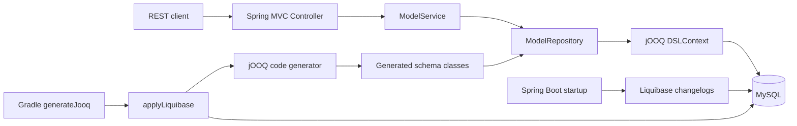

# Architecture and schema lifecycle

The checked-in jOOQ classes enable an ordinary Gradle build without a database. For a new schema change, write an **additional** Liquibase changeset rather than editing an already-applied changeset. Run `./gradlew generateJooq`: the Gradle dependency first invokes Liquibase against the configured MySQL schema, then introspects the migrated schema. Review and commit changes in the generated jOOQ source files when a migration changes the table or column contract.

## Example of schema evolution

- Initial migration creates `Saiyans`.
- Seed migration adds five example records.
- Follow-up migration `2-add-saiyan-name-index` adds `idx_saiyans_name`, with explicit rollback.
- An integration test checks JDBC index metadata to verify that the new migration was applied.

The new migration adds an index rather than changing the Java row shape, so checked-in generated classes need no changes. This demonstrates **versioned schema evolution** without requiring a separate application feature.
